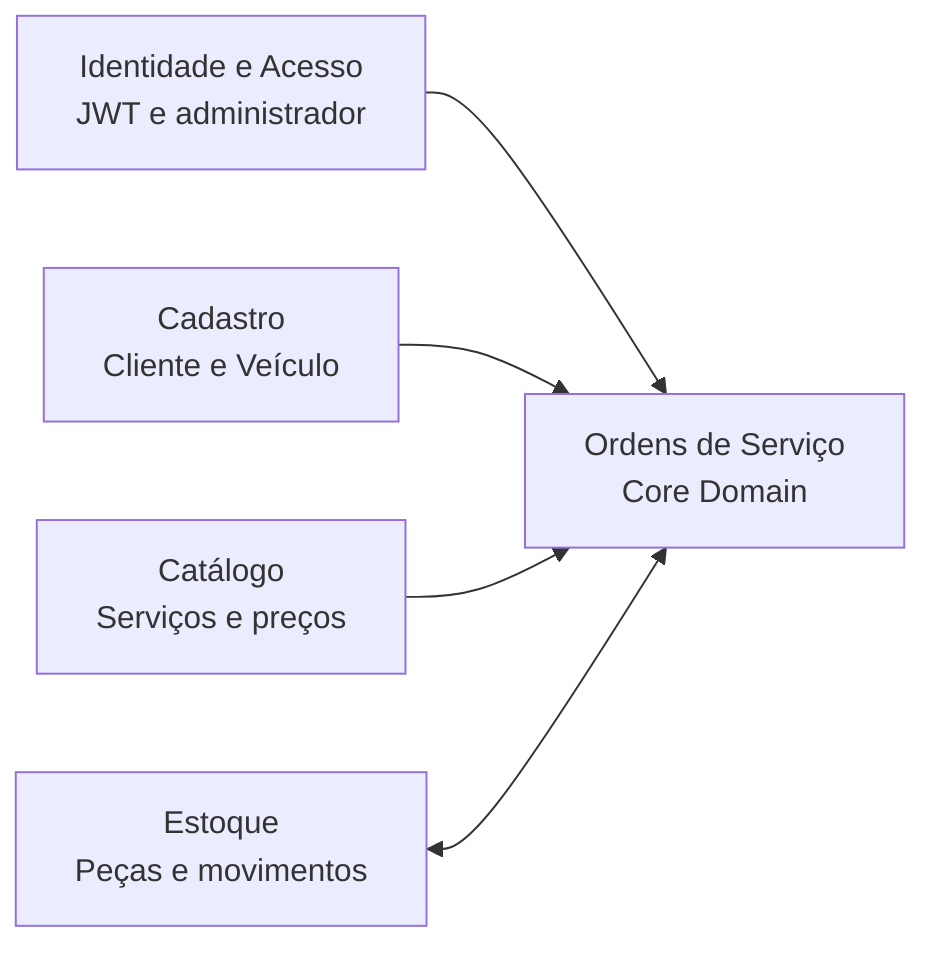
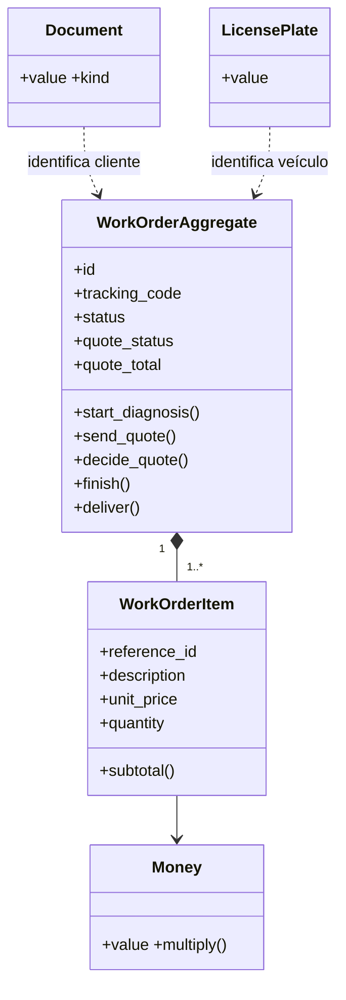
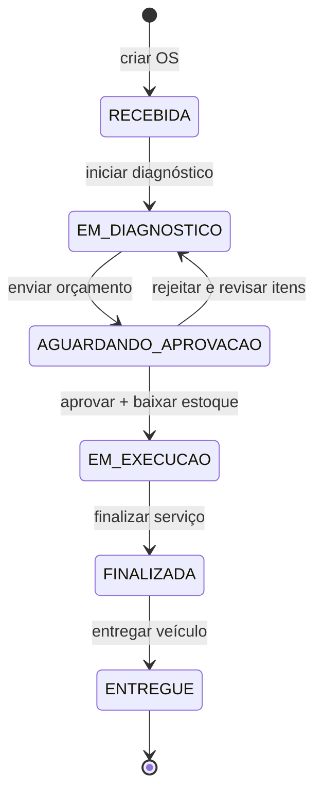
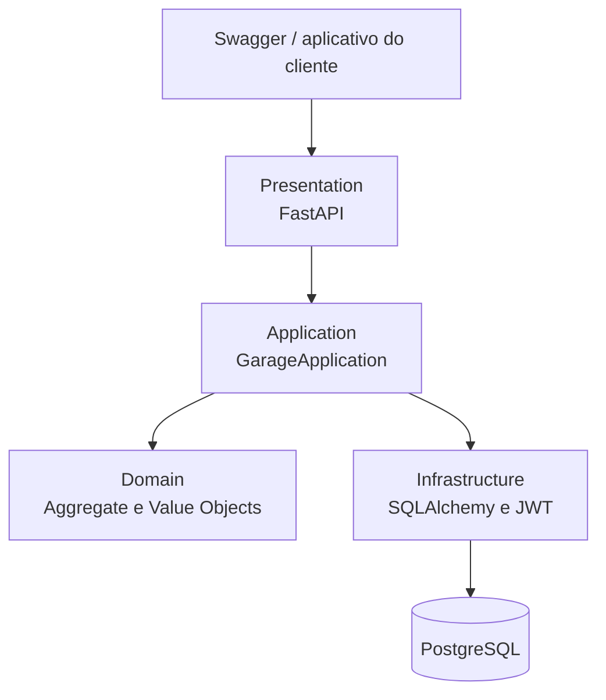
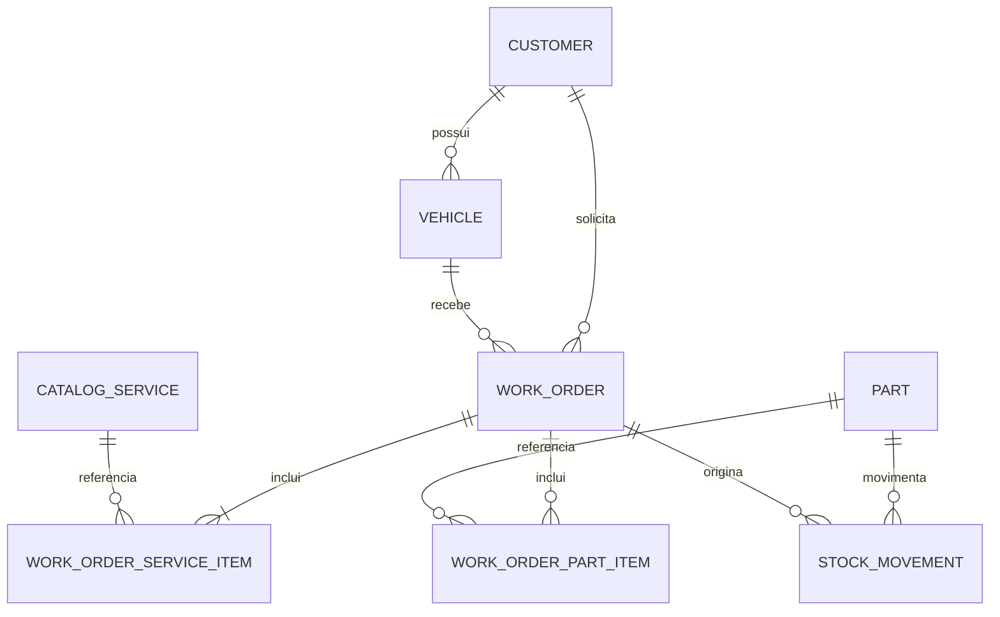

# Diagramas DDD e arquitetura

## Bounded Contexts

- **Ordens de Serviço** é o Core Domain.
- **Cadastro**, **Catálogo** e **Estoque** são contextos de suporte.
- **Identidade e Acesso** é um subdomínio genérico.
- No MVP eles vivem no mesmo deploy e no mesmo banco, com separação lógica. Não são
  microsserviços.

## Agregados, entidades e objetos de valor

O agregado `WorkOrderAggregate` é a fronteira de consistência das transições. A peça
é outra raiz de consistência para estoque; sua atualização é coordenada com a OS pela
transação do caso de uso de aprovação.

## Máquina de estados

## Componentes do monólito

## Modelo de dados resumido

