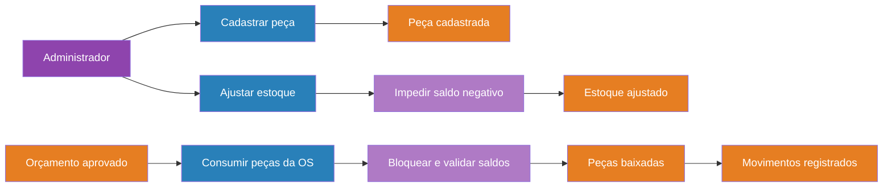

# Event Storming

Legenda: ator em roxo, comando em azul, evento em laranja, política em lilás e
agregado em amarelo. As setas representam a ordem causal, não comunicação assíncrona.

## Criação da Ordem de Serviço

Regras associadas:

- CPF/CNPJ e placa precisam ser válidos;
- placa existente não pode ser apropriada por outro cliente;
- preços são copiados do catálogo;
- ao menos um serviço é obrigatório.

## Acompanhamento, orçamento e execução

```mermaid
flowchart LR
  T[Técnico]:::actor --> C1[Iniciar diagnóstico]:::command
  C1 --> E1[Diagnóstico iniciado]:::event
  E1 --> C2[Enviar orçamento]:::command
  C2 --> E2[Orçamento aguardando aprovação]:::event
  E2 --> CL[Cliente]:::actor
  CL --> C3[Aprovar ou rejeitar]:::command
  C3 --> P1{Decisão?}:::policy
  P1 -->|Rejeitado| E3[Orçamento rejeitado]:::event
  E3 --> C4[Revisar itens]:::command
  C4 --> E1
  E3 --> C7[Devolver veículo sem execução]:::command
  C7 --> E7
  P1 -->|Aprovado| P2[Validar e baixar estoque]:::policy
  P2 --> E4[Orçamento aprovado]:::event
  E4 --> E5[Execução iniciada]:::event
  E5 --> C5[Finalizar OS]:::command
  C5 --> E6[OS finalizada]:::event
  E6 --> C6[Entregar veículo]:::command
  C6 --> E7[Veículo entregue]:::event

  classDef actor fill:#8e44ad,color:#fff;
  classDef command fill:#2980b9,color:#fff;
  classDef event fill:#e67e22,color:#fff;
  classDef policy fill:#af7ac5,color:#fff;
```

Regras associadas:

- rejeição não movimenta estoque;
- revisão após rejeição retorna a OS ao diagnóstico;
- após rejeição, o veículo também pode ser entregue sem execução;
- aprovação e baixa de estoque pertencem à mesma transação;
- transições fora da sequência são recusadas.

## Gestão de peças e insumos

Estoque é um subdomínio de suporte com CRUD e regras transacionais no serviço de
aplicação; não há um agregado rico de estoque no código deste MVP.

## Catálogo de eventos de domínio levantados

- ClienteIdentificado;
- VeículoAssociado;
- OrdemDeServiçoRecebida;
- ItensDaOrdemAtualizados;
- OrçamentoCalculado;
- DiagnósticoIniciado;
- OrçamentoEnviado;
- OrçamentoAprovado / OrçamentoRejeitado;
- ExecuçãoIniciada;
- EstoqueBaixado;
- OrdemDeServiçoFinalizada;
- VeículoDevolvidoSemExecução;
- VeículoEntregue.

No MVP, esses eventos são representados por mudanças de estado transacionais. Uma
evolução poderá publicá-los em uma outbox, sem mudar a linguagem do domínio.

